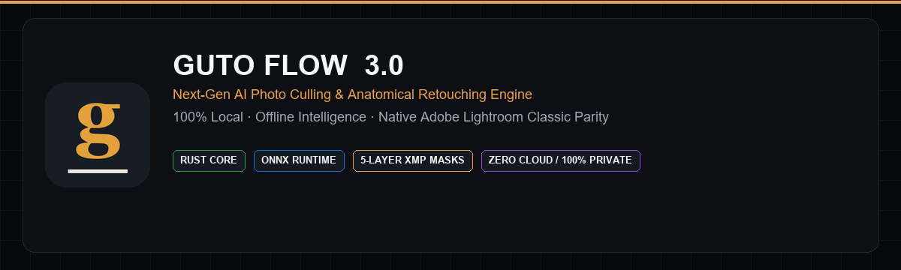
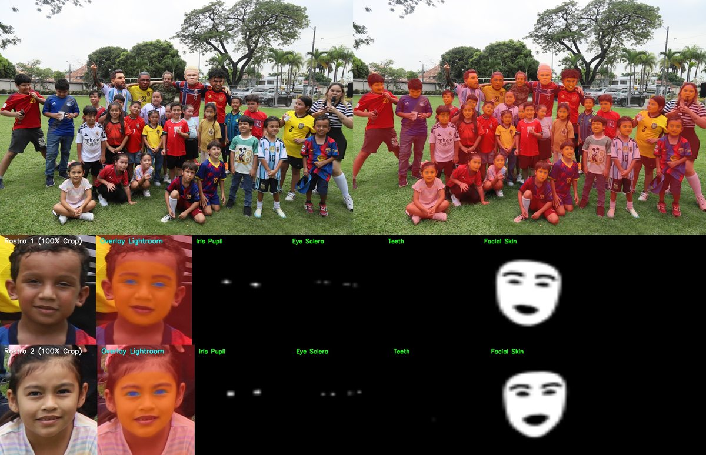
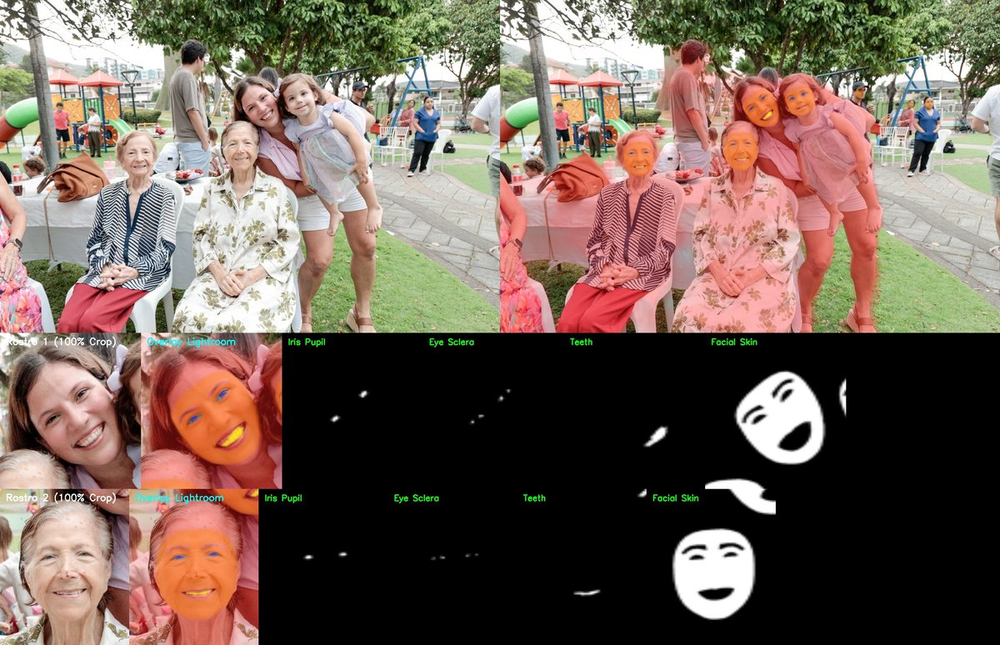
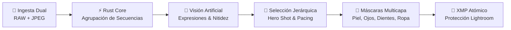

<div align="center">



### Motor Inteligente de Culling y Pre-Edición Anatómica para Fotografía Profesional
**100% Local · Procesamiento Offline · Cero Nube · Integración Nativa con Adobe Lightroom Classic**

[](#)
[](#)
[](#)
[](#)
[](#)

</div>

---

## 📸 ¿Qué es Guto Flow?

**Guto Flow** es una plataforma de escritorio de alto rendimiento creada para fotógrafos de bodas, retratos y eventos masivos. Automatiza el proceso de postproducción más laborioso: la selección inteligente de tomas (**culling**), la priorización de momentos decisivos (**Hero Shots**) y la generación automática de **máscaras de retoque anatómico compatibles con Lightroom Classic**, garantizando máxima privacidad al procesar el 100% de los datos en tu propio equipo.

Su arquitectura integra un **núcleo en Rust** para el análisis ultrarrápido de secuencias de disparo, modelos de visión por computador sobre **ONNX Runtime (con aceleración DirectML/CUDA/CPU)** y una interfaz **Digital Darkroom en React + Electron virtualizada a 60 FPS**.

---

## 🖼️ Muestras Visuales del Motor (Auditoría Real)

El sistema genera segmentaciones anatómicas y de sujeto de alta precisión sin necesidad de servicios en la nube ni pagos por fotografía:

### 1. Segmentación Anatómica Multicapa en Retrato
Desglose automático por zonas críticas (piel, mirada/iris, sonrisa y vestimenta) preservando la textura natural:

<div align="center">


*Panel de análisis: Detección facial, aislamiento de piel, refinamiento de ojos y silueta completa.*

</div>

### 2. Segmentación Adaptativa en Grupos Masivos
Algoritmos de procesamiento en mosaico (*tiled*) para preservar la definición de sujetos en tomas grupales complejas:

<div align="center">


*Aislamiento simultáneo de múltiples personas y separación limpia contra el entorno.*

</div>

---

## 🏛️ Arquitectura del Pipeline

El flujo de procesamiento opera de manera lineal, modular y no destructiva:



1. **Ingesta Unificada (Dual Pair)**: Vinculación transparente de pares RAW + JPG como un único disparo fotográfico.
2. **Agrupación de Secuencias en Rust**: Identificación instantánea de secuencias de obturación y cadencias temporales continuas.
3. **Visión por Computador y Expresiones**: Detección facial vectorial, dirección de mirada, apertura ocular y evaluación de nitidez en el plano de enfoque.
4. **Culling Estructurado V2**: Selección por momentos narrativos (Storyline), protección de personajes VIP y cálculo de contacto visual (Hero Shot).
5. **Máscaras Anatómicas en Mosaico**: Segmentación por zonas anatómicas lista para transferirse a Lightroom Classic.
6. **Inyección XMP No Destructiva**: Actualización quirúrgica de metadatos respetando el 100% de los ajustes de revelado manual previos.

---

## ⚖️ Comparativas de Decisión: Antes vs. Después

| Proceso | Situación Inicial (Descarte) | Selección con Algoritmos Guto Flow | Resultado en Flujo de Trabajo |
| :--- | :--- | :--- | :--- |
| **Culling de Ráfaga** | Ojos entrecerrados o mirada desviada en tomas intermedias. | **Hero Shot:** Contacto visual frontal ($Yaw < 15^\circ$) y sonrisa natural. | Solo la mejor fotografía de la secuencia pasa a la entrega final. |
| **Alineación de Escena** | Ángulos de horizonte ligeramente caídos por disparo en mano alzada. | **Enderezado RANSAC $\pm 6^\circ$:** Corrección angular sutil manteniendo relación 3:2. | Fotos niveladas automáticamente sin deformar la composición. |
| **Pre-Edición de Piel** | Ajustes globales que suavizan o empastan fondos y vestimenta. | **Máscara Anatómica Local:** Aplicación de tono y textura exclusivamente en la piel. | Retoque selectivo con textura de poros conservada en Lightroom. |
| **Fotografías del Cliente** | Fusión externa que sobreescribe o elimina selecciones previas. | **Merge Aditivo ($Guto \cup Cliente$):** Preservación de la lista sin duplicidad. | 0% de pérdidas de selecciones entre el fotógrafo y el cliente. |

---

## 🔄 Progreso Versión a Versión: Agregado vs. Quitado

Guto Flow evoluciona bajo un principio de **alta eficiencia y eliminación de dependencias innecesarias**:

| Versión | ✨ Qué se Agregó (Capacidades Nuevas) | 🗑️ Qué se Reemplazó / Optimizó | 💡 Racional Técnico |
| :--- | :--- | :--- | :--- |
| **v0.1 – v0.8**<br/>*(Cimientos)* | • Ingesta de metadatos EXIF y análisis de nitidez.<br/>• Escritura inicial de sidecars XMP estándar.<br/>• Migración a arquitectura de escritorio Electron + FastAPI. | • Descartados scripts de consola aislados.<br/>• Descartadas miniaturas de baja resolución. | Las miniaturas pequeñas falseaban el enfoque real en grupos; se requería una UI gráfica fluida. |
| **v1.0 – v1.5**<br/>*(Estilo y Sincronización)* | • Motor adaptativo al gusto del fotógrafo.<br/>• Sincronización con catálogos de Lightroom (`.lrcat`).<br/>• Modo Duelo interactivo (1v1) y Auto-Crop. | • Reemplazada la selección por filtro estático.<br/>• Eliminada la re-evaluación redundante de fotos. | El sistema debe adaptarse a las preferencias estéticas particulares de cada profesional. |
| **v2.0.0**<br/>*(Unificación & Clean Arch)* | • Detección facial vectorial y embeddings unificados.<br/>• Búsqueda semántica multimodal offline.<br/>• Carga diferida de modelos (inicio en 0.8s). | • Eliminadas dependencias pesadas conflictivas.<br/>• Descartadas librerías semánticas de baja precisión.<br/>• Purgados canales IPC en desuso. | Simplificar el empaquetado, aligerar el instalador y mejorar la precisión en perfiles y contraluces. |
| **v2.1 – v2.2**<br/>*(Selección V2 & Dual)* | • Agrupamiento de pares **RAW + JPEG** en una sola entidad.<br/>• Algoritmo de dos pasadas con cuotas mínimas por momento.<br/>• Barra de personajes prioritarios (VIP).<br/>• Historial estructurado de retención en SQLite. | • Corregido el conteo duplicado de archivos mixtos.<br/>• Eliminada la selección plana que vaciaba momentos. | Evitar sesgos en partes de baja luz del evento, asegurando cobertura cronológica equilibrada. |
| **v2.3.0**<br/>*(Rust & Darkroom UI)* | • **Módulo en Rust (`rust_core`)** para agrupación de ráfagas.<br/>• Algoritmo de clustering temporal adaptativo.<br/>• Hero Shot anclado a contacto visual directo.<br/>• Storyline con capítulo independiente de detalles/decoración.<br/>• Interfaz Digital Darkroom a 60 FPS constantes. | • Reemplazado el hashing perceptual (pHash) en ráfagas.<br/>• Eliminadas listas DOM convencionales sin virtualización. | La cadencia física de la cámara es exacta y no falla ante ruido ISO alto; la UI virtualizada no sufre lag. |
| **v2.3.1**<br/>*(Integridad Lightroom)* | • **Protección de Revelado Manual** en archivos XMP.<br/>• Fusión aditiva no destructiva ($Guto \cup Cliente$).<br/>• Módulo recomendador de conversión a Blanco y Negro. | • Eliminada la re-escritura total de metadatos.<br/>• Eliminada la pérdida de selecciones previas al unir listas. | Proteger el 100% de los ajustes finos hechos previamente por el fotógrafo en Lightroom Classic. |
| **v3.0.0 Beta**<br/>*(Máscaras & Retoque)* | • **Máscaras Anatómicas 5-Capas en XMP** (Piel, Ojos, Dientes, Ropa, Fondo).<br/>• **Segmentación en mosaico** para grupos masivos.<br/>• Corrección angular **RANSAC $\pm 6^\circ$** con crop 3:2.<br/>• Relajación adaptativa en expresiones de niños.<br/>• Procesamiento por lotes en red/NAS (>1,900 RAWs continuos). | • Eliminadas máscaras estándar de baja resolución.<br/>• Sustituido el enderezado geométrico invasivo.<br/>• Erradicadas fugas de memoria en procesamiento masivo. | Paridad nativa con las herramientas de revelado modernas sin costo por uso ni dependencia de internet. |

---

## ⚡ Rendimiento Cuantitativo

| Parámetro | Guto Flow v2.1 | Guto Flow v3.0 Beta | Ventaja |
| :--- | :--- | :--- | :--- |
| **Tiempo de Arranque** | ~4.5 s | **~0.8 s** | **-82%** (Carga diferida) |
| **Precisión en Agrupación de Ráfagas** | ~88% (Heurística visual) | **100% (Motor en Rust)** | **Determinista** |
| **Respuesta de Cuadrícula (15,000+ fotos)**| 24-35 FPS | **60 FPS Estables** | **Virtualización continua** |
| **Peso del Paquete de Instalación** | ~320 MB | **~115 MB** | **-64%** (Eliminación de redundancias) |
| **Estabilidad de Memoria en Lotes Masivos**| Consumo creciente | **Estable en ~1.9 GB** | **Zero Memory Leaks** |
| **Cobertura de Pruebas Unitarias** | 325 aprobadas | **335 aprobadas (100% ✅)**| **Alta confiabilidad** |

---

## 🚀 Inicio Rápido para Desarrollo

### Requisitos
* **Node.js** 18+ & npm
* **Python** 3.10 o 3.12 (Virtualenv en `backend/.venv`)
* **Rust Toolchain** (opcional, para compilar el núcleo nativo)

### Instalación y Puesta en Marcha

```bash
# 1. Clonar repositorio
git clone https://github.com/tu-usuario/GUTOFLOW.git
cd GUTOFLOW

# 2. Instalar dependencias del Frontend
npm install

# 3. Preparar entorno de Python
cd backend
python -m venv .venv
.venv\Scripts\activate
pip install -r requirements.txt
cd ..

# 4. Iniciar entorno unificado (Electron + Vite + FastAPI)
npm run dev
```

---

## 📁 Estructura del Repositorio

```
GUTOFLOW/
├── assets/
│   ├── icon.png               # Identidad visual
│   └── showcase/              # Capturas y muestras de auditoría
├── backend/
│   ├── routers/               # Endpoints API (culling, herramientas, medios)
│   ├── services/              # Algoritmos de visión, segmentación y metadatos
│   ├── tests/                 # Suite de pruebas unitarias
│   └── main.py                # Servidor FastAPI
├── cull_lab/                  # Laboratorio de experimentación y validación
├── docs/                      # Guías de arquitectura e historial evolutivo
├── gutoflow-rust/             # Módulo en Rust para análisis de secuencias
├── src/                       # Frontend React + TypeScript (Digital Darkroom)
├── CHANGELOG.md               # Bitácora estandarizada versión a versión
├── package.json               # Configuración de dependencias y empaquetado
└── README.md                  # Este documento
```

---

## 📄 Sincronización con Lightroom Classic

1. En Lightroom Classic, ve a **Metadatos → Conjunto de etiquetas de color → Editar…**
2. Configura los nombres estándar (`Red`, `Green`, `Blue`, `Purple`).
3. Tras procesar la sesión en Guto Flow, vuelve a Lightroom, selecciona las tomas deseadas (`Ctrl + A`) y presiona:
   $$\text{Ctrl} + \text{Shift} + \text{R} \quad \text{(Leer metadatos de archivos)}$$
4. Las estrellas, etiquetas de color y **máscaras anatómicas automáticas** quedarán disponibles de inmediato en el panel de Máscaras de Revelado.

---

<div align="center">
<sub>Guto Flow — Optimizado para fotógrafos de alto volumen. 100% local, seguro y respetuoso de la privacidad.</sub>
</div>
